<!-- ══════════════════════════════════════════════════════════════════
     DOASTRA  ·  deterministic, fact-safe conversational AI
     brand profile · ocean-teal identity carried from the LTET product
     ══════════════════════════════════════════════════════════════════ -->

  

    

  

    

  
  
  
   
  
  
  

    

  

    

  ### What DOASTRA builds

  Conversational AI that answers **only what can be verified** — a voice assistant
  for the LTET Employee Trust Portal that resolves claim-status, payment and
  beneficiary enquiries across **22 languages**, then hands processors
  **auditable post-call intelligence** instead of a black box.

   

  | Principle | What it means at DOASTRA |
  |---|---|
  | **Deterministic** | The same verified enquiry yields the same answer — every time |
  | **Fact-safe** | Responses come from verified portal records, never free generation |
  | **Auditable** | Every call ends in post-call intelligence processors can review |
  | **Governed** | Controlled administration; privacy-first verification (PS + name + DOB) |
  | **Zero keys** | Runs with no external API keys; neural voice (Sarvam AI) is optional |

    

  

